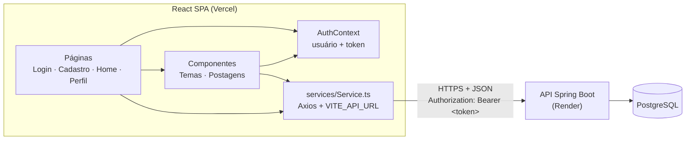
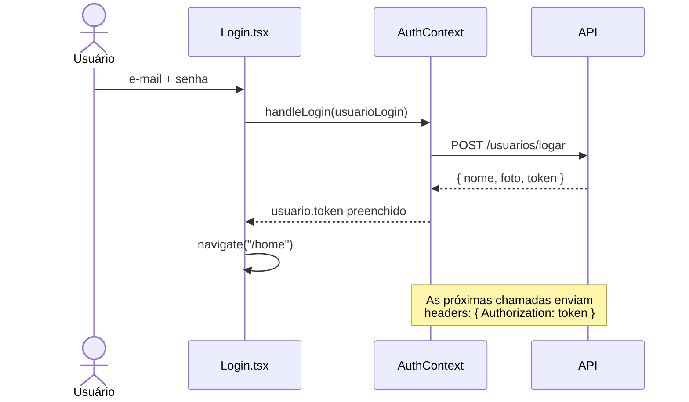

<div align="center">

# 📝 Blog Pessoal — Front-end

Interface web do Blog Pessoal: login, cadastro, perfil e o CRUD de postagens e temas, consumindo uma [API REST em Spring Boot](https://github.com/Day-Barbosa/blog-pessoal-api) com autenticação JWT.


[](https://github.com/Day-Barbosa/blog-pessoal-web/actions/workflows/ci.yml)


**[🌐 Aplicação ao vivo](https://blog-pessoal-web-gilt.vercel.app)** · **[⚙️ Repositório da API](https://github.com/Day-Barbosa/blog-pessoal-api)** · **[📖 Swagger](https://blog-pessoal-paet.onrender.com)**

<sub>A API está no plano gratuito do Render: o primeiro login depois de um tempo parado pode levar ~50 s.</sub>

</div>

---

<!-- 📸 MÍDIA: grave um GIF de ~15 s (login → home com postagens → nova postagem no modal → editar → deletar) e salve em docs/demo.gif. Depois troque este comentário por:
<p align="center"></p>
-->

## 💡 Sobre o projeto

Front-end de uma plataforma de blog em que a pessoa usuária **se cadastra, faz login e gerencia as próprias postagens por tema**. O foco foi a integração real com um back-end protegido: o token JWT recebido no login fica em um contexto global e vai no header `Authorization` de todas as requisições. Se o token expira, a aplicação faz logout automático.

## 🏗️ Arquitetura e decisões técnicas



| Decisão | Por quê |
|---|---|
| **Vite + React 19 + TypeScript** | Build rápido e tipagem dos modelos (`Postagem`, `Tema`, `Usuario`) espelhando as entidades da API. |
| **Context API para autenticação** | Um único `AuthContext` guarda usuário e token e expõe `handleLogin` / `handleLogout` para toda a árvore, sem biblioteca extra. |
| **Camada `services/` com Axios** | As chamadas HTTP ficam centralizadas e tipadas com genéricos. A URL base vem de `VITE_API_URL`, então o mesmo código aponta para local ou produção. |
| **Logout em `401`** | Toda chamada trata `401` encerrando a sessão, para a pessoa não ficar presa com token expirado. |
| **Tailwind CSS 4** | Estilo utilitário direto no JSX e layout responsivo sem CSS solto. |
| **`vercel.json` com rewrite** | Rotas da SPA (`/home`, `/postagens`...) funcionam ao recarregar a página ou abrir um link direto. |

### Fluxo de login



## ✨ Funcionalidades

- Cadastro de usuário com confirmação de senha e validação no formulário
- Login com JWT e logout automático quando o token expira (`401`)
- Rotas protegidas: sem login, a pessoa é redirecionada para a tela inicial
- **Temas:** listar, cadastrar, editar e excluir (com tela de confirmação)
- **Postagens:** listar, criar (inclusive em modal na home), editar e excluir, sempre vinculadas a um tema
- Página de perfil com foto e dados da pessoa logada
- Feedback visual com *toasts* (`react-toastify`) e *spinners* de carregamento
- Layout responsivo com Tailwind CSS

<!-- 📸 MÍDIA: tire 3 prints (1280 px de largura) e salve em docs/:
     docs/login.png · docs/home.png · docs/form-postagem.png
     Depois troque este comentário por:
<p align="center">
  
  
  
</p>
-->

## 🗺️ Rotas

| Rota | Página |
|---|---|
| `/` | Login |
| `/cadastro` | Cadastro de usuário |
| `/home` | Página inicial com as postagens |
| `/temas` · `/cadastrartema` · `/editartema/:id` · `/deletartema/:id` | Gestão de temas |
| `/postagens` · `/cadastrarpostagem` · `/editarpostagem/:id` · `/deletarpostagem/:id` | Gestão de postagens |
| `/perfil` | Perfil da pessoa logada |

## 🚀 Como rodar localmente

**Pré-requisito:** Node.js 20+.

```bash
git clone https://github.com/Day-Barbosa/blog-pessoal-web.git
cd blog-pessoal-web
npm install
cp .env.example .env.local      # opcional: aponta para a API local
npm run dev
```

Abra **http://localhost:5173**.

- **Sem `.env.local`**, o front usa a API em produção no Render.
- **Com a API local**, suba o [blog-pessoal-api](https://github.com/Day-Barbosa/blog-pessoal-api#-como-rodar-localmente) (`./mvnw spring-boot:run`) e mantenha `VITE_API_URL=http://localhost:8080`.

| Script | O que faz |
|---|---|
| `npm run dev` | Servidor de desenvolvimento com HMR |
| `npm run build` | Checagem de tipos (`tsc -b`) + build de produção |
| `npm run lint` | ESLint (TypeScript + regras de hooks do React) |
| `npm run preview` | Serve o build localmente |

O GitHub Actions roda `lint` e `build` a cada push.

## 📁 Estrutura

```text
src/
├── components/     # Navbar, Footer, Temas e Postagens (listar, card, form, modal, deletar)
├── contexts/       # AuthContext: sessão e token JWT
├── models/         # Tipos: Postagem, Tema, Usuario, UsuarioLogin
├── pages/          # Login, Cadastro, Home, Perfil
├── services/       # Cliente Axios e funções de acesso à API
└── utils/          # ToastAlerta
```

## 🗺️ Próximos passos

- [ ] Persistir a sessão (hoje, recarregar a página exige novo login)
- [ ] Testes de componentes com Vitest + Testing Library
- [ ] Exibir as mensagens de validação que a API devolve por campo

## 👩‍💻 Autora

**Dayana Barbosa** · [LinkedIn](https://www.linkedin.com/in/dayanabarbosa-devjava/) · [GitHub](https://github.com/Day-Barbosa)

Projeto desenvolvido na formação Java Fullstack da Generation Brasil.

---

<sub>Distribuído sob a licença MIT. Veja [`LICENSE`](LICENSE).</sub>
